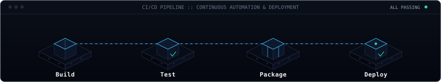

  

 

### About Me
I am a Computer Engineer working on full-stack web development and systems programming. I focus on building practical tools, writing maintainable code, and understanding low-level fundamentals.

- Building web applications with TypeScript, Next.js, and Node.js.
- Designing databases and APIs with PostgreSQL, MySQL, and Prisma.
- Writing low-level logic in C and C++, and working on Linux environments.

---

### Engineering Matrix

| Project | Architecture & Stack | Focus & Implementation | Status |
| :--- | :--- | :--- | :--- |
| **[ANZAAD](https://anzaad.studio)** | Next.js · TypeScript · Tokens | Multi-Archetype Arabic design system, strict BiDi isolation & typography | `● active` |
| **[MindDrop](https://github.com/waleealedi/minddrop)** | TypeScript · React · Local-First | Low-friction thought capture & deterministic state persistence | `● online` |
| **[Systems / C-Runtime](https://github.com/waleealedi)** | C / C++ · Linux Kernel · POSIX | Custom memory allocators, core data structures & low-level CLI utilities | `● continuous` |

---

  

---

### Contributions

  <picture>
    <source media="(prefers-color-scheme: dark)" srcset="https://raw.githubusercontent.com/waleealedi/waleealedi/output/github-snake-dark.svg">
    <source media="(prefers-color-scheme: light)" srcset="https://raw.githubusercontent.com/waleealedi/waleealedi/output/github-snake.svg">
    
  </picture>

---

  Find me on: <a href="https://bsky.app/profile/ws404">Bluesky</a> · <a href="https://instagram.com/ws404k">Instagram</a>

